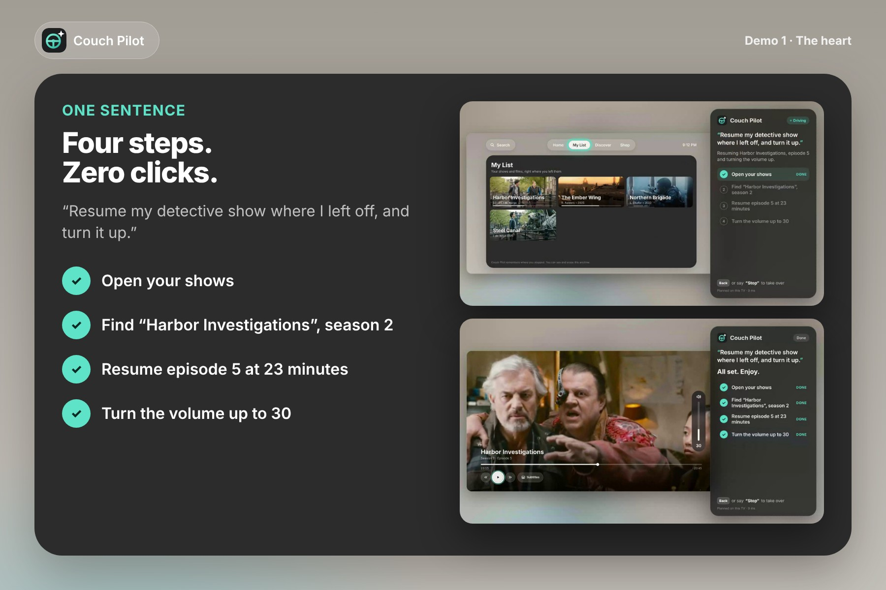

<p align="center"></p>

<h1 align="center">Couch Pilot</h1>
<p align="center"><b>The self-driving remote. Say the goal, it drives the TV.</b><br>
<i>Alexa+ understands what you say. Couch Pilot does what you want.</i></p>

<p align="center"></p>

Couch Pilot is an agent that drives the TV for you. You give it a **whole goal in one sentence**:

> "Resume my detective show where I left off, and turn it up."

It turns the goal into a **plan**, shows the plan on screen, then **executes every step itself** (open your shows → find the series → resume S2·E5 at 23:12 → volume to 30) while you watch each step check off. It asks **one** short question when it isn't sure, needs a **clear yes** for anything that costs money, and a single word (**"Stop"**) or the **Back** button hands control back instantly.

It is built first for the people the remote left behind (older adults, people with low vision or motor impairments) and it's just as nice for everyone else on the couch.

- **Alexa+ track:** Couch Pilot is a self-hosted **MCP server (spec 2025-11-25, Streamable HTTP)** that gives Alexa+ "hands" on the TV, plus a simulated Alexa+ experience (a real MCP client) in the repo.
- **Fire TV track:** the TV app runs on **Fire OS** as an Android TV app (Kotlin WebView wrapper, D-pad, Android speech recognition and TTS).

**Who is the AI?** In the Alexa+ path, Alexa+ is the conversational AI: it understands the user and hands Couch Pilot a goal through MCP. Couch Pilot is the part that *acts*: it plans the TV steps, enforces the guardrails and drives the screen. On the TV itself, a fast on-device planner (no cloud, works offline) handles the remote's mic button.

**Live demo (no install):** https://couchpilot.netlify.app (open it full screen, click "try a demo" or press **M**)  
Demo video: _add your YouTube/Vimeo link here_

---

## Quick start (2 minutes)

Requirements: **Node.js 18+** (tested on Node 22).

```bash
git clone https://github.com/chessoren/couchpilot.git
cd couchpilot
npm install
npm start
```

Then open:

| URL | What it is |
| --- | --- |
| http://localhost:8787/ | **The TV app** (open full screen, 16:9). Press **M** (or ☰ on a Fire TV remote) to talk to Couch Pilot. |
| http://localhost:8787/alexa | **Alexa+ (simulated)**: chat with Alexa+, which calls the Couch Pilot MCP server; the TV tab drives itself. |
| http://localhost:8787/mcp | **MCP endpoint** (Streamable HTTP, protocol 2025-11-25) for any MCP client. |

No API key is needed. Everything runs locally with the on-device planner.

### Keyboard / remote

| Key (browser) | Fire TV remote | Action |
| --- | --- | --- |
| Arrow keys, Enter | D-pad, Select | Navigate, press |
| **M** or **/** | **☰ Menu** | Talk to Couch Pilot (mic in Chrome, otherwise type) |
| **Esc** or Backspace | **Back** | Stop the agent instantly / go back |
| Space | Play/Pause | Play / pause |
| T (Shift+T = 30 min) | | Demo only: move the TV clock forward to see reminders and sleep timers fire |

Touching any remote key while the agent is driving also stops it, so the agent never "fights" the user.

## Reproduce the four demos

Open http://localhost:8787/?fresh (the `fresh` flag resets the household memory), press **M**, and say or type:

| # | Say | What happens |
| --- | --- | --- |
| 1 | **Resume my detective show where I left off, and turn it up.** | Plan of 4 steps; the TV opens My List, finds Harbor Investigations S2, resumes E5 at 23:12, volume to 30. |
| 2 | **Put on something for the kids.** | One question with two numbered tiles. Answer with **▼ / ▲ + OK** on the remote (or "the first one"). Kids mode, volume capped at 15, stops in 30 min. |
| 3 | **Movie night.** | Routine: resumes The Ember Wing, English subtitles (the agent opens the subtitle menu itself), volume 30, reminder at 11 PM. Press **Shift+T** a few times to see the reminder fire. |
| 4a | **Rent Dune Song.** then **No** | Stops at the paid step: "This rental costs $3.99. Should I go ahead?". Default focus is **No**. "No" → "Okay, nothing was charged." (Rentals are simulated: no payment is ever made.) |
| 4b | **Find me a documentary about space, under an hour.** then **Stop** (or press Esc) | Stops mid-plan, remaining steps are marked skipped: "Okay, stopping. You're in control." |

More things it understands: "Go back 30 seconds and turn on subtitles", "Subtitles in French", "Turn everything off in 10 minutes", "Same as yesterday", "Quiet mode", "Kids mode", "Pause". It refuses "Type my password", "Turn off parental controls", and grown-up titles while kids mode is on.

The same flows through MCP, from the Alexa+ simulator (http://localhost:8787/alexa) or any MCP client:

```bash
npm run test:e2e   # a real MCP client drives a real TV page (headless Chromium) through all four demos
```

## Run it on a Fire TV (Fire OS)

The Fire OS app is in [`android/`](android/). It bundles the web app from `web/` as assets, so it works offline.

```bash
cd android
# needs the Android SDK (platform 34, build-tools 34) and JDK 17+
gradle assembleDebug          # or open the folder in Android Studio
adb connect <fire-tv-ip>:5555 # Fire TV: Settings > My Fire TV > Developer options > ADB debugging
adb install -r app/build/outputs/apk/debug/app-debug.apk
```

A prebuilt APK is in [`dist/couchpilot-fire-tv.apk`](dist/). Couch Pilot appears in **Your Apps & Channels**.

- **☰ Menu** = talk to Couch Pilot. Many Fire TV models keep the microphone pipeline for Alexa; when Android speech recognition isn't available the app falls back to the on-screen keyboard, and the **Alexa+ / MCP path** is the voice path.
- **Back** = stop. **D-pad** = navigate. Speech output uses the Fire OS text-to-speech engine.
- To connect the TV to a Couch Pilot server (MCP / Alexa+ mode), start it with:
  `adb shell am start -n com.couchpilot.tv/.MainActivity --es server http://<your-computer-ip>:8787`

## Optional: cloud planner on Amazon Bedrock (experimental, off by default)

```bash
export COUCHPILOT_PLANNER=bedrock
export AWS_REGION=us-east-1                    # any region where the model is enabled
export BEDROCK_MODEL_ID=amazon.nova-pro-v1:0   # default; any Converse + tool-use model works
# credentials through the standard AWS chain (AWS_PROFILE, env vars, SSO...)
npm start
```

Not used in the demo and not part of the submission; it is an extension point. The server then plans each sentence with the Bedrock **Converse API**, forcing a `submit_plan` tool whose schema only allows the actions in the allow-list. The plan is re-checked by `enforceGuardrails()` before anything runs. If Bedrock fails (no access, throttling, timeout), the TV silently uses the on-device planner, and an auth error switches the cloud planner off for 10 minutes. The agent panel shows which planner made each plan. See [`server/bedrock.js`](server/bedrock.js).

## How it works

```
 Alexa+ (or any MCP client) ──tools/call──▶ Couch Pilot MCP server ──SSE──▶ TV app (Fire TV / browser)
   "Movie night"                             /mcp · 2025-11-25              planner → guardrails → executor
                                             Streamable HTTP                drives the real UI, step by step
        ◀──── result / needs_input ◀──────────────────────────── HTTP POST ◀── done · question · stopped
```

| Path | Role |
| --- | --- |
| [`web/js/planner.js`](web/js/planner.js) | On-device planner: one sentence → plan (multi-intent clauses, routines, household memory, clarifications). Action registry with trust levels and `enforceGuardrails()`. Isomorphic (browser + Node). |
| [`web/js/pilot.js`](web/js/pilot.js) | The agent loop: listen → understand → show the plan → drive → confirm. Executor, retries (max 2, then hands back), clarification, confirmation, Stop. |
| [`web/js/tv.js`](web/js/tv.js) | The TV: screens, spatial focus engine (D-pad), player, volume, subtitles, timers. The agent uses the same primitives as the remote (focus, press, type). |
| [`web/js/app.js`](web/js/app.js) | Wiring: Alexa+ (simulated) voice bar, remote keys, server bridge, Fire OS bridge. |
| [`server/mcp.js`](server/mcp.js) | MCP server: `couchpilot_run_goal`, `couchpilot_answer`, `couchpilot_stop`, `tv_get_state`, 7 primitives (`tv_play_title`, `tv_set_volume`, `tv_set_subtitles`, `tv_seek`, `tv_navigate`, `tv_schedule`, `tv_rent_title`), resources `couchpilot://catalog` and `couchpilot://guardrails`, tool annotations. |
| [`server/index.js`](server/index.js) | HTTP server: static app, `/mcp` (stateless Streamable HTTP), TV bridge (SSE + POST), `/api/plan`, `/api/alexa`. |
| [`server/alexa-sim.js`](server/alexa-sim.js) + [`web/alexa.html`](web/alexa.html) | Alexa+ (simulated): a real MCP client (official SDK) that chooses the tool, relays questions and speaks the result. Shows the MCP traffic. |
| [`server/bedrock.js`](server/bedrock.js) | Cloud planner on Amazon Bedrock (Converse API + tool use). |
| [`android/`](android/) | Fire OS app (Kotlin): WebView + asset loader, D-pad, Menu = mic, Back = stop, SpeechRecognizer, TextToSpeech. |
| [`tests/`](tests/) | `npm test` (planner unit tests), `npm run test:e2e` (MCP end-to-end against a live TV page). |

### Trust levels (enforced in code, whatever planner made the plan)

| Level | Actions | Behaviour |
| --- | --- | --- |
| Free | navigate, open, play, pause, seek, volume, subtitles, reminders, sleep timer, kids mode on | Acts alone, shows every step |
| Confirm | rent / buy, power off | Shows the price or consequence, waits for a clear yes (default focus on **No**) |
| Forbidden | passwords, PIN codes, payment details, parental controls, disabling a safety setting | Refuses politely and hands control back |

An MCP client cannot bypass the confirmation: `tv_rent_title` returns `needs_input` and only the user's answer through `couchpilot_answer` (or the remote) continues.

## Accessibility and design choices

- Readable from the couch: large type, strong contrast, never more than five lines at a time.
- Colour never carries meaning alone: every completed step has a ✓, the word "Done", and the accent colour.
- The TV shrinks to the left while the agent drives, so you **see** it navigate; one focus ring glides from target to target.
- Choices are numbered so you can answer "the two" without seeing the screen; every message can be read aloud.
- No long-press or double-press anywhere. The panel disappears once the video plays.
- Household memory (where you stopped, preferences) is shown in My List and erasable (`couchPilot.forget()` or `?fresh`).

## Content and credits

The catalog (Harbor Investigations, Pampas Pals, The Ember Wing, ...) is **fictional**. Artwork and clips come from Blender Foundation open movies under Creative Commons Attribution. See [CREDITS.md](CREDITS.md). No third-party brands, no copyrighted music.

## Hackathon documents

- [docs/PRODUCT_FEEDBACK.md](docs/PRODUCT_FEEDBACK.md): product feedback for every tool, API and SDK used
- [docs/FRICTION_LOG.md](docs/FRICTION_LOG.md): friction log
- [docs/DEMO_SCRIPT.md](docs/DEMO_SCRIPT.md): reliable demo phrases and the shooting checklist

## License

[MIT](LICENSE)
